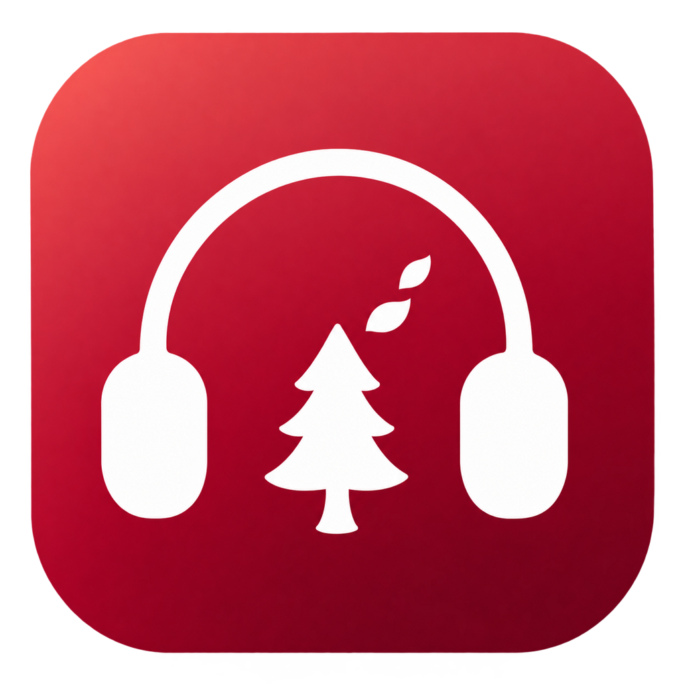
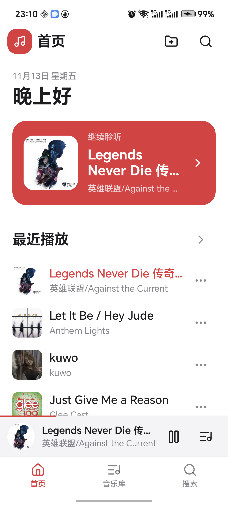
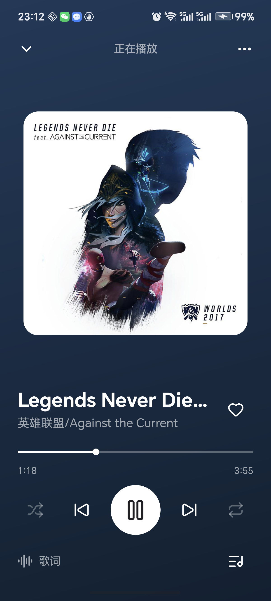
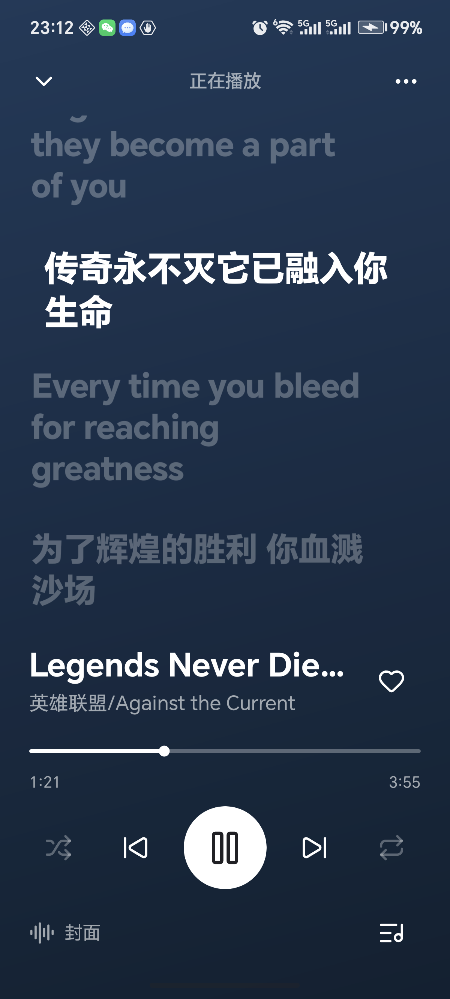
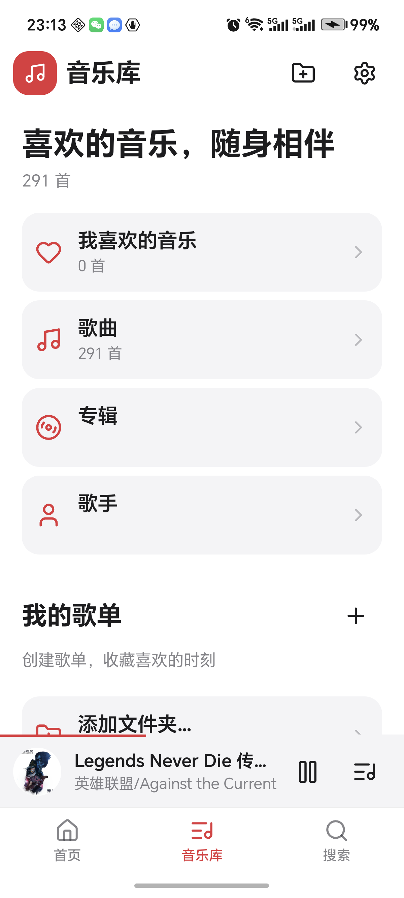
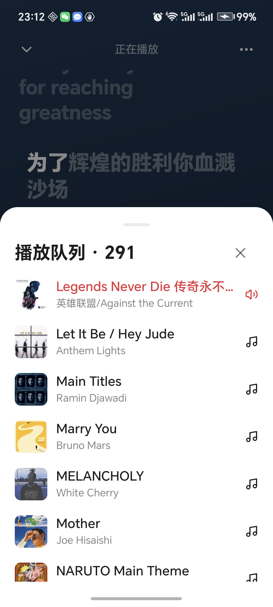
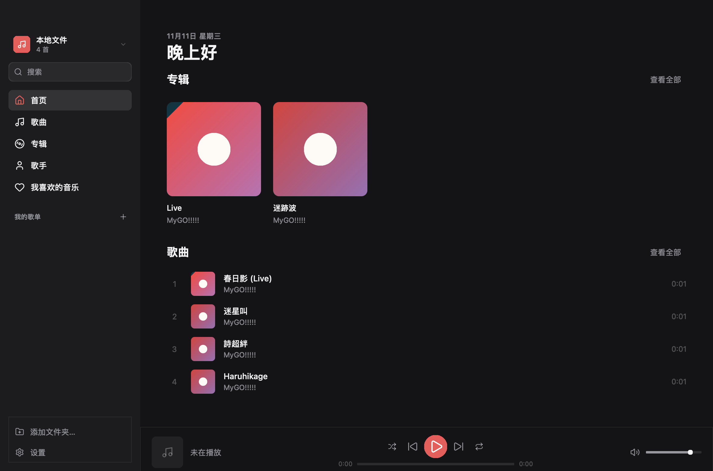
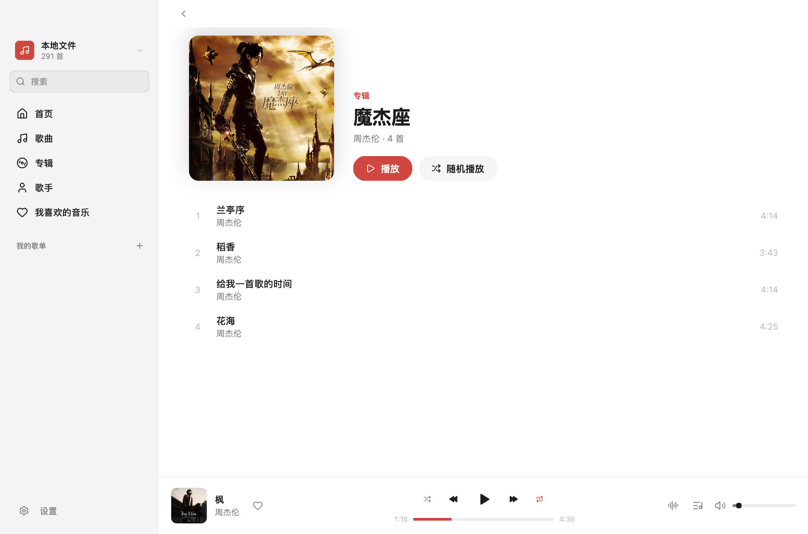
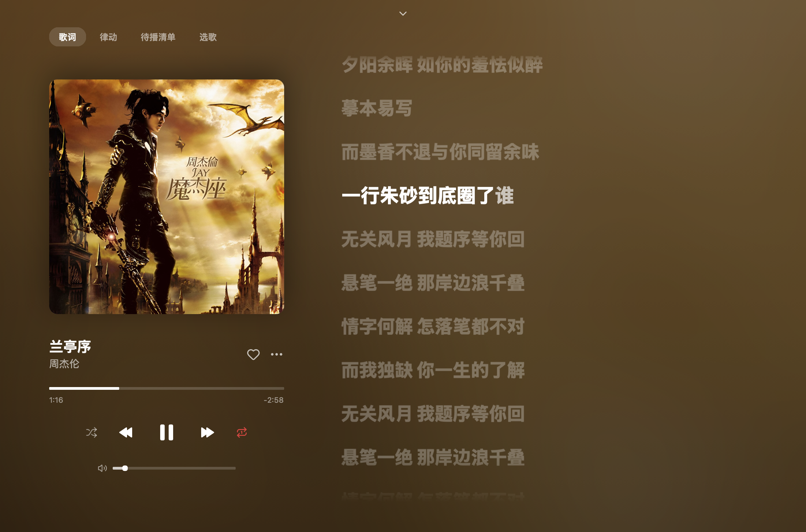
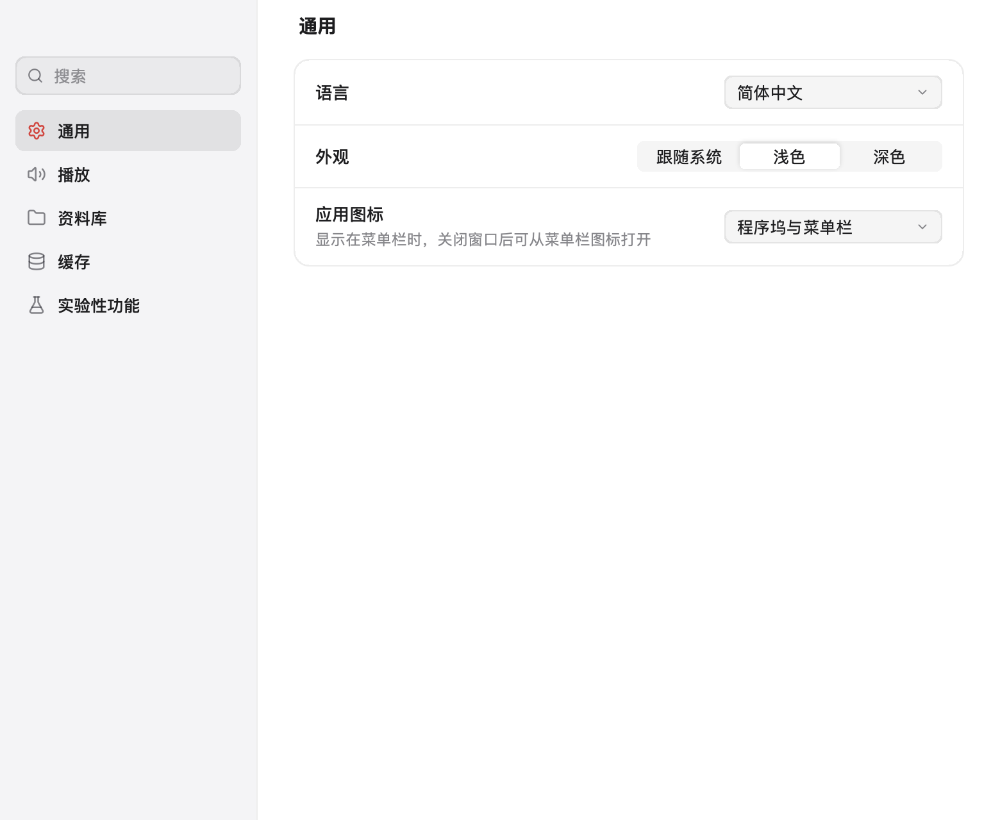

<p align="center">
  
</p>

# 木听风音乐 · Wood & Wind Music

基于 [NSGo](https://github.com/nsgo-dev/nsgo) 的本地音乐播放器，支持桌面与安卓，由 [MyGo Music](https://github.com/egoist/mygo-music) 复刻与移植而来。

这是一个持续开发中的个人自用项目，主要用于本地音乐播放，以及探索 NSGo 的桌面界面与交互。开发与功能取舍以个人使用需求为主，源码公开供参考。

NSGo 提供窗口、界面渲染和交互框架；MyGo Music 是界面设计、交互、文案，以及播放、曲库、歌词和队列等核心实现的来源。项目在迁移 UI 框架的基础上，进行平台适配与体验调整。详见[致谢](#致谢)与[许可证](#许可证)。

当前主要在 **macOS Apple Silicon（arm64）** 上开发与验证。

安卓端已接入 NSGo 的 `core.Video` 原生媒体播放，提供 arm64 APK；已在荣耀 GT（Android 16）完成曲库导入、实际歌曲播放进度、后台/熄屏播放及系统媒体控制验证。

现已补充 **Windows x64** 构建与桌面适配，提供安装包和便携版。当前已完成交叉编译和共享功能测试，Windows 真机播放与系统集成仍待验收。详见 [Windows 使用与验证](docs/WINDOWS.md)。

## 界面预览

以下截图来自本地曲库，界面仍在持续调整。

### 安卓移动端

以下为 **荣耀 GT · Android 16** 上的实际应用截图。播放示例选用本地歌曲《Legends Never Die 传奇永不熄》，展示封面取色背景、歌词与迷你播放条。

<table>
  <tr><th>首页</th><th>正在播放</th><th>歌词</th></tr>
  <tr>
    <td></td>
    <td></td>
    <td></td>
  </tr>
</table>

<details>
<summary>查看音乐库、播放队列与手机设置</summary>

<table>
  <tr><th>音乐库</th><th>播放队列</th><th>设置</th></tr>
  <tr>
    <td></td>
    <td></td>
    <td></td>
  </tr>
</table>

</details>

移动端交互与验证范围见 [安卓移动端界面](docs/ANDROID-MOBILE-UI.md)，后台和锁屏实测记录见 [Android 真机验证](docs/ANDROID-VALIDATION.md)。

### 桌面端



<details>
<summary>查看专辑、正在播放与设置界面</summary>







</details>

更多布局示例见[窄窗口歌词预览](docs/lyrics-narrow.png)。

## 功能与移植范围

### 已实现

- 本地文件：MP3、FLAC、Ogg Vorbis、WAV、M4A（ALAC/FLAC/AAC）与 AAC，含标签、内嵌封面、同目录封面、`.lrc` 歌词
- 首页、最近播放、专辑/歌手/歌曲页、搜索结果（歌曲/专辑/歌手/歌单）
- 歌单：新建、重命名、删除、添加/移除歌曲、上下移动
- 喜欢的音乐
- 播放器：队列、随机、单曲/列表循环、进度拖动、音量、暂停淡出、响度归一化、磁盘缓存、会话恢复
- Now Playing：封面、歌词、舞台（Flow / Steps / Tilt 与 Sparks）、接下来、封面墙；歌词逐字高亮、当前行缩放与淡入淡出、点击跳转、手动浏览后恢复跟随，背景随封面取色
- 首页主推卡片、专辑/歌手/歌单卡片、歌手页歌曲/专辑切换、查看全部、搜索历史下拉与设置页侧栏/搜索
- 侧栏、返回/前进、搜索历史、空状态
- 设置窗口：侧栏分页与搜索（通用、播放、资料库、缓存、实验性功能）、跟随系统/English/简体中文、外观、应用图标（程序坞与菜单栏）、音质、音量均衡、重新扫描与添加/移除目录、缓存上限与清除
- macOS：隐藏标题栏、自绘顶部区域、菜单栏图标、媒体键与系统“正在播放”
- Windows：WASAPI 输出、原生托盘与窗口恢复、系统媒体控制适配、主窗口内设置页
- Android：独立手机布局、底部导航、迷你播放条、大封面/歌词切换、队列与歌曲操作面板，以及后台/熄屏播放和系统媒体控制
- 英文与简体中文，跟随系统语言

普通 LRC 的逐字进度沿用上游逻辑，将每行时长分配给行内文字。音质设置会传给支持音质选择的音乐源。

### 当前范围

当前主要围绕本地播放与界面打磨。以下上游能力尚未移植，也不作为功能承诺：

- 插件系统（JS 宿主、安装/更新、插件源、登录窗口、评论、播客、电台）
- 播客字幕与本地语音识别（sherpa-onnx）
- 雾效、进度条烟雾、封面飞入与封面墙的自由拖动等细节动画
- 自动更新与勾选通知等发布相关功能

刘海迷你播放器明确不在移植范围内。实验性功能面板中的雾效、进度条烟雾和封面飞入设置仍保留，相关效果尚未完成移植。

## 开发与运行

需要 Go 1.26 或更高版本。NSGo 尚未发布，本项目与框架同步开发，通过 `go.mod` 中的 `replace` 使用相邻目录中的 NSGo 源码。

### 环境准备

将 NSGo 与本项目放在同一级目录：

```text
workspace/
├── nsgo/
└── woodwind-music/
```

```sh
git clone https://github.com/nsgo-dev/nsgo.git
git clone https://github.com/HengWh/woodwind-music.git
cd woodwind-music
```

### 常用命令

在项目根目录执行：

```sh
go tool nsgo dev        # 开发运行，保存后热重载
go tool nsgo test       # 无窗口运行全部测试
go tool nsgo check      # 静态检查
go tool nsgo build      # 按 nsgo.yaml 的目标本地打包
```

启动后，点击侧栏底部的“添加文件夹…”导入本地音乐。

### 安卓真机运行

当前 NSGo 安卓运行时要求 **Android 9（API 28）或更高版本**；这里打包的是 arm64 真机版本。

手机开启开发者选项和 USB 调试，连接电脑并允许调试。本项目提供独立安卓宿主以支持后台播放。在 macOS Apple Silicon 的项目根目录执行：

```sh
./android/bootstrap.sh
go run ./cmd/android -install -run
```

也可以先生成 APK，稍后再安装：

```sh
go run ./cmd/android
.tools/android/platform-tools/adb install -r "dist/releases/woodwind-music-0.1.25-android-arm64.apk"
```

APK 位于 `dist/releases/`，版本号跟随 `nsgo.yaml`。安卓安装后统一显示中文名称“木听风音乐”，桌面图标和系统应用信息使用 `android/AndroidManifest.xml` 中的名称，媒体会话也沿用该名称。本地构建沿用 NSGo 的调试签名，保留安装后的数据。`-device <序列号>` 选择手机，`-debug` 允许开发检查。工具优先使用 `ANDROID_HOME`、`JAVA_HOME`、`R8_JAR` 和 `ADB`，否则使用项目 `.tools/android/` 下的工具。

请用 `go run ./cmd/android` 构建完整安卓包。裸 `go tool nsgo build -target android_arm64` 只会生成框架的基础包，不含本项目的后台播放宿主。

手机顶部的文件夹按钮或「音乐库 → 添加文件夹…」打开系统目录选择器。安卓选择的目录会将音乐、封面和 LRC 歌词**复制到应用私有存储**，然后进入现有曲库；导入会占用额外空间，原目录后续变化不会自动同步，需要重新导入。复制完成后无需保持外部目录授权即可再次播放；设置中的“移除目录”只移除曲库记录，不删除导入副本，卸载或清除应用数据才会清除这些副本。

安卓端通过 `core.Video` 调用系统 MediaPlayer，复用现有队列、随机、单曲/列表循环、歌词和会话恢复；手机宽度下使用独立的移动端界面：首页、音乐库和搜索位于底部导航，单行迷你播放条常驻其上；全屏播放页支持大封面/歌词切换，队列和歌曲菜单从底部展开。三个入口分别保留浏览层级与滚动位置，系统返回键按层关闭面板、播放页、设置并返回上一页。界面预览与验证范围见 [安卓移动端界面](docs/ANDROID-MOBILE-UI.md)。页面和主题切换不会重建播放节点。

与桌面端不同，安卓使用系统解码，具体格式支持取决于系统与设备；解码失败会显示错误。当前不经过 Go 的 PCM 混音链路，因此不提供桌面端的暂停淡出、频谱分析和音频下载缓存，响度增益上限为 1。`core.Video` 没有自定义 HTTP 请求头接口，需要请求头的网络音源会明确报错。本项目目前仍以本地音乐为主。

安卓宿主提供 `mediaPlayback` 前台服务、系统 MediaSession、媒体通知和锁屏/耳机控制。播放时保持 CPU 唤醒，暂停时释放；临时失去音频焦点时暂停并在恢复焦点后继续，永久失去焦点或拔出耳机时暂停。播放中的 NSGo 运行时由服务保留，界面离开或销毁后不主动停止；再次打开会接回同一个运行时。暂停五分钟后退出前台服务，界面也已关闭时释放运行时。系统强制停止应用仍会停止播放。

建议真机按顺序检查：导入包含中文名称的音乐目录；播放 WAV、MP3、FLAC、AAC/M4A；暂停/恢复、静音与音量；拖动进度；上一首/下一首、随机与循环；打开歌词和队列；退出重开后恢复到暂停位置。蓝牙切换、音频焦点以及切后台/锁屏的实际表现也应单独记录。

<details>
<summary>本地打包与图标更新</summary>

应用名称、ID、版本和构建目标在 `nsgo.yaml` 中配置。当前打包目标为 `macos_arm64`、`windows_x64`，产物保存在 `dist/`，安装镜像与安装包保存在 `dist/releases/`。单独构建 Windows 使用 `go tool nsgo build -target windows_x64`，随后运行 `go run scripts/package-windows.go` 生成便携版；完整说明见 [Windows 使用与验证](docs/WINDOWS.md)。

开发运行与本地打包使用相同图标，macOS 使用预生成的 `resources/icon.icns`。更新图标后，在项目根目录执行：

```sh
go run ./icon       # 更新应用 PNG 与 macOS ICNS
go run ./icon/tray  # 更新菜单栏图标
```

旧的 `.icon` 文档不参与当前构建。图标打包无需 `actool`；需要完整 Xcode 的其他构建步骤可通过 `DEVELOPER_DIR=/Applications/Xcode.app/Contents/Developer` 指定工具链。

</details>

## 测试与验证

日常回归使用 `go tool nsgo test` 与 `go tool nsgo check`，无需启动真实应用窗口。现有 UI 测试覆盖设置窗口、主题切换、歌词交互，以及主窗口和播放条的尺寸变化。

<details>
<summary>专项回归与真实窗口截图</summary>

设置窗口回归覆盖侧栏刷新、重复打开、隐藏后唤回和关闭后重开：

```sh
go tool nsgo test -run TestSettingsWindowSurvivesSidebarUpdates
```

页面截图覆盖首页、专辑、歌手、播放页、舞台、封面墙、队列、搜索和歌单等：

```sh
WOODWIND_SHOTS=1 go tool nsgo test -target macos -run TestShots
open .nsgo/test/screenshots/macos
```

设置与歌词的专项截图使用固定播放位置，覆盖深浅主题、下拉菜单、长文本、无歌词与窄窗口：

```sh
(cd internal/app && WOODWIND_UI_SHOTS=1 go tool nsgo test -target macos -run TestUIShots)
open internal/app/.nsgo/test/screenshots/macos
```

截图测试使用独立的临时应用数据。

</details>

## 项目结构

| 路径 | 内容 |
| --- | --- |
| `main.go` | 入口，交给 `internal/app` |
| `internal/app` | 窗口、页面、播放条、Now Playing、设置与菜单 |
| `internal/player` | 播放队列、流式解码、缓存、淡入淡出、会话恢复 |
| `internal/audio` | 各平台音频输出，以及 MP3、FLAC、Vorbis、AAC、ALAC、WAV 解码 |
| `internal/local` | 本地文件源：扫描、标签、封面、播放列表、喜欢、最近播放 |
| `internal/music` | 播放器与视图共用的音乐模型和源接口 |
| `internal/lyrics` | LRC 解析与逐字歌词 |
| `internal/nowplaying` | macOS / Windows 播放信息与系统媒体命令桥接 |
| `internal/winshell` | Windows 原生托盘、窗口恢复与系统媒体会话 |
| `internal/i18n` | 英文 / 简体中文 |
| `resources`、`icon` | 应用图标与生成工具 |
| `docs` | 供目视核对的界面截图 |

## 致谢

木听风音乐（Wood & Wind Music）的实现离不开以下两个开源项目：

- **[NSGo](https://github.com/nsgo-dev/nsgo)**：为本项目提供原生桌面应用框架，承载窗口、界面渲染和交互。感谢 NSGo 作者与贡献者的开发和维护，让使用 Go 构建原生应用成为可能。
- **[MyGo Music](https://github.com/egoist/mygo-music)**：是本项目复刻与移植的基础。界面设计、交互、文案，以及音频播放、曲库、歌词和队列等核心实现均源自该项目。感谢其作者与贡献者对产品细节的打磨，以及开放源码供大家学习和继续构建。

本项目主要将 MyGo Music 的界面迁移到 NSGo，并根据个人使用需求进行平台适配与体验调整。感谢两个项目的作者与贡献者。

## 许可证

上游 mygo-music 为 AGPL-3.0，本项目作为其复刻/衍生作品同样以 AGPL-3.0 发布，见 [LICENSE](LICENSE) 与 [NOTICE](NOTICE)。NSGo 为 Apache-2.0；`internal/audio` 来自 MIT 许可的 MyGo，见 [LICENSES/MyGo-MIT.txt](LICENSES/MyGo-MIT.txt)。
