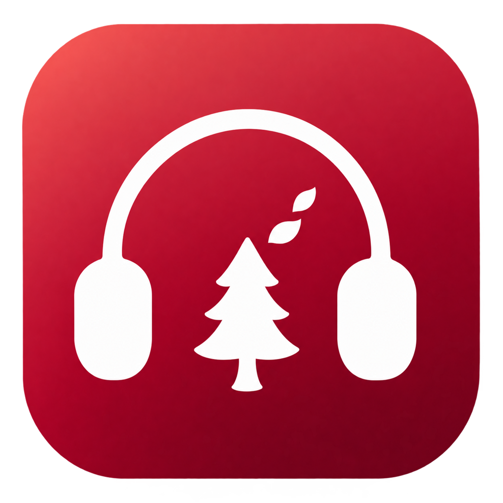
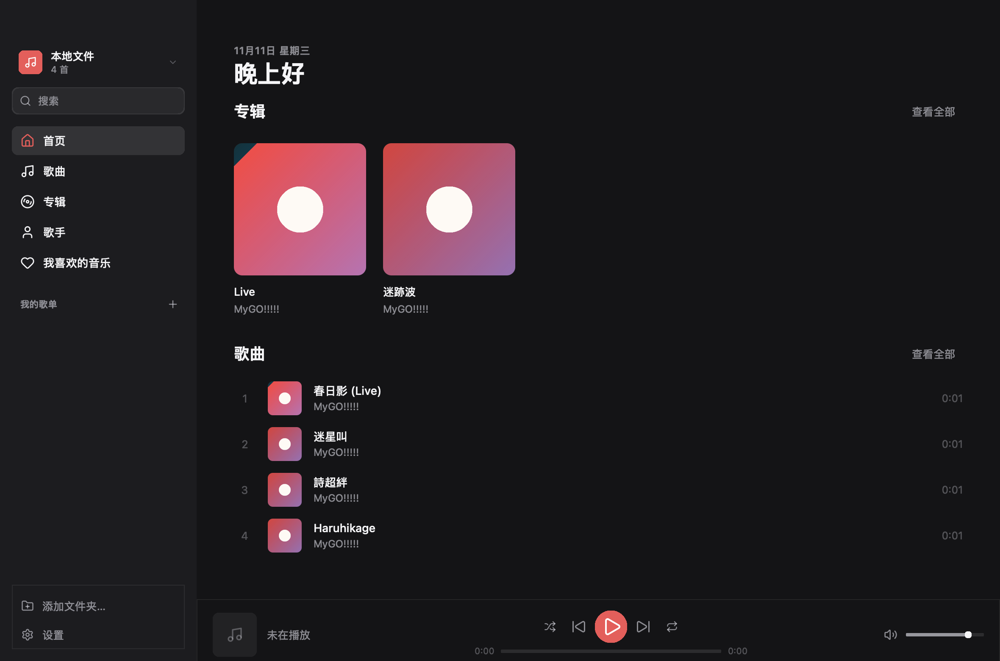
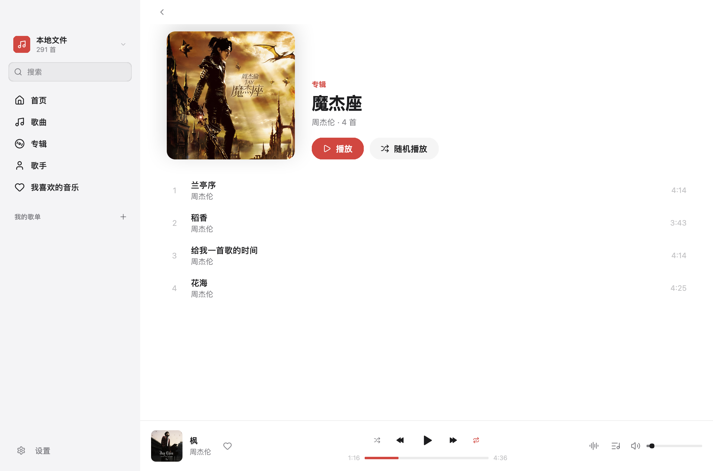
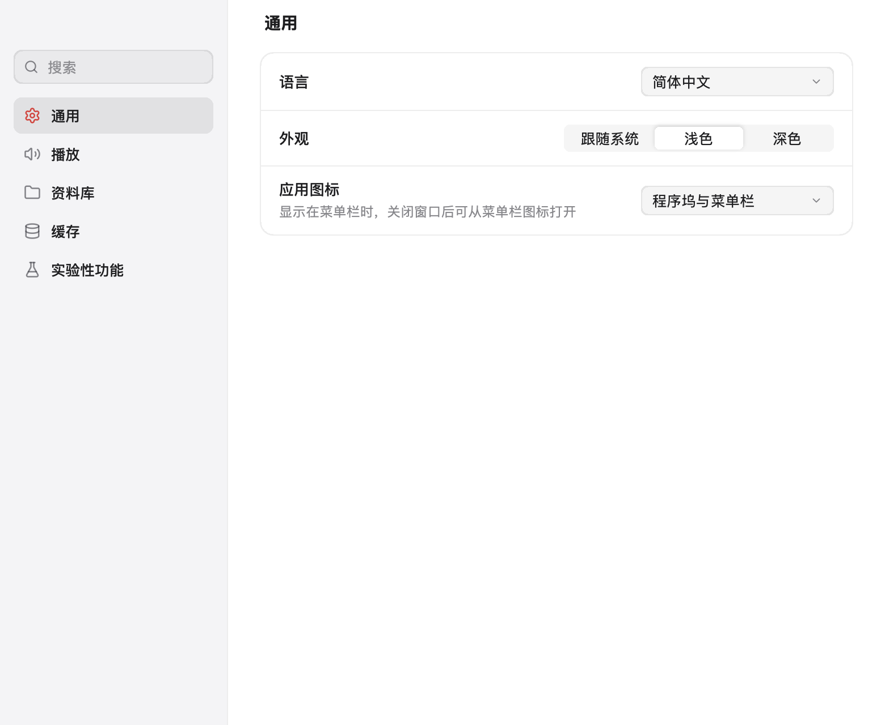
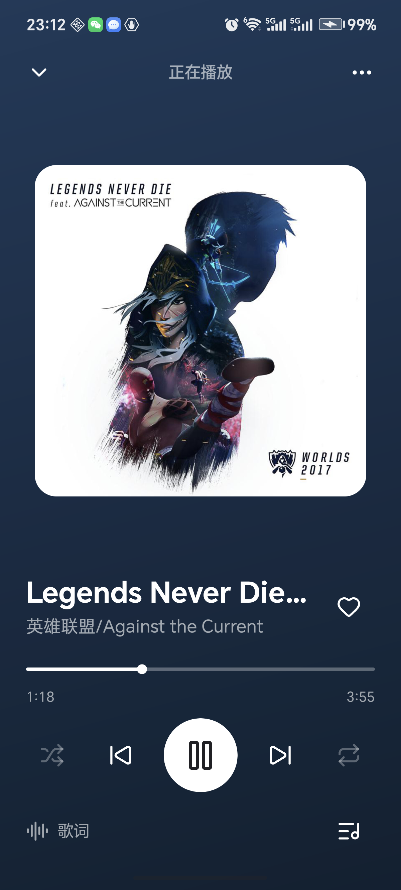
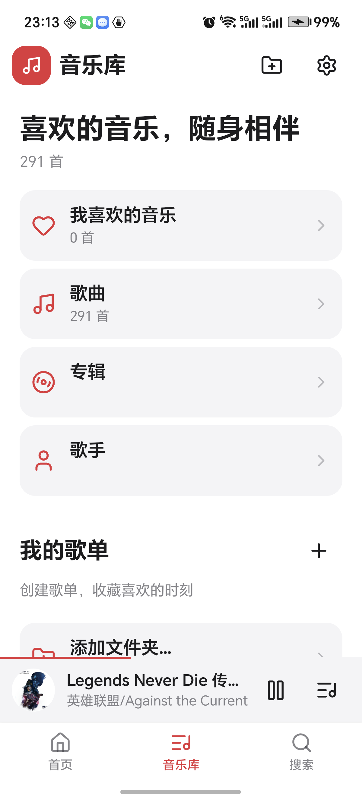
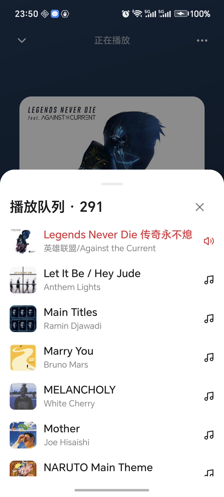

<p align="center">
  
</p>

<h1 align="center">木听风音乐 · Wood &amp; Wind Music</h1>

<p align="center">用熟悉的曲库，在桌面和手机上继续聆听。</p>

<p align="center">
  macOS · Windows · Android<br />
  本地音乐 · 插件音乐源 · 同步歌词 · 歌单与收藏
</p>

木听风音乐是一款基于 Go 与 [NSGo](https://github.com/nsgo-dev/nsgo) 构建的音乐播放器，由 [MyGo Music](https://github.com/egoist/mygo-music) 复刻与移植而来。支持管理和播放本地音乐，也可以通过兼容的 JS/TS 插件接入其他音乐源。

桌面端采用侧栏、曲库卡片和底部播放条；安卓移动端提供独立的手机界面、底部导航、全屏播放页，以及后台和熄屏播放。两种界面共用曲库、队列、歌词、歌单与会话恢复逻辑。

这是一个持续开发中的个人自用开源项目，功能与体验会随实际使用继续调整。

[下载与安装](#下载与安装) · [界面预览](#界面预览) · [功能介绍](#功能介绍) · [开始使用](#开始使用) · [开发与构建](#开发与构建)

## 平台支持

| 平台 | 当前构建 | 支持情况 |
| --- | --- | --- |
| macOS | Apple Silicon / arm64，DMG | 主要开发与验证平台；支持菜单栏、媒体键和系统“正在播放” |
| Windows | Windows 10 / 11 x64，安装版与便携版（实验性支持） | 已完成构建与共享逻辑回归，已接入 WASAPI、托盘和系统媒体控制；完整真机验收仍待完成 |
| Android | Android 9+ / API 28+，arm64 APK | 独立手机界面；已在荣耀 GT（Android 16）验证曲库导入、实际歌曲播放、后台/熄屏播放与系统媒体控制 |

当前移动端支持 Android，尚未提供 iOS 版本。macOS Intel、Windows ARM64 和 Linux 暂无本项目的发布构建。桌面与手机上的数据分别保存在本机，当前没有跨设备同步。

## 下载与安装

在 [GitHub Releases](https://github.com/HengWh/woodwind-music/releases) 查看发布版本与附件；也可以按下文从源码构建。下载时根据系统和处理器架构选择对应文件，文件名中的 `<版本>` 随发布版本变化。

| 平台 | 文件名 | 安装方式 |
| --- | --- | --- |
| macOS | `wood-wind-music-<版本>-macos-arm64.dmg` | 打开镜像，将 `木听风音乐.app` 拖入“应用程序” |
| Windows 安装版 | `wood-wind-music-<版本>-windows-x64-setup.exe` | 运行安装程序，安装到当前用户目录 |
| Windows 便携版 | `wood-wind-music-<版本>-windows-x64-portable.zip` | 解压后运行 `木听风音乐.exe`，保留同目录资源文件 |
| Android | `wood-wind-music-<版本>-android-arm64.apk` | 在手机上打开 APK，按系统提示允许对应来源安装 |

本地构建的 Windows 程序尚未做代码签名，Android 包沿用 NSGo 的调试签名。升级前请退出桌面应用；安卓使用相同签名覆盖安装可保留现有数据。发布包附带 `.sha256` 校验文件。

**0.1.0 为首个公开版本**，基于 NSGo 0.1.0；三平台使用相同的应用版本。Android 内部版本码为 131，可从此前私用的 0.1.30 覆盖升级。发布包不预装第三方音乐源插件，不包含账号、Cookie、登录凭据或个人曲库；新安装默认使用本地音乐，插件需自行安装和登录。覆盖升级会继续保留本机已有数据。完整变更见 [0.1.0 发布说明](docs/RELEASE-0.1.0.md)。

Windows 便携版表示无需安装，它与安装版仍共用当前用户的应用数据。更多说明见 [Windows 使用与验证](docs/WINDOWS.md)。

## 界面预览

### 桌面端



<details>
<summary>查看专辑、正在播放与设置</summary>






</details>

### 安卓移动端

0.1.30 的 FM、设置、歌词、列表与搜索优化见 [移动端体验优化记录](docs/MOBILE-POLISH-2026-11-15.md)。

以下截图来自荣耀 GT、Android 16、应用 0.1.26，保留 115% 系统字体设置，使用本地实际曲库。

<table>
  <tr><th>首页</th><th>正在播放</th><th>歌词</th></tr>
  <tr>
    <td></td>
    <td></td>
    <td></td>
  </tr>
</table>

<details>
<summary>查看音乐库、播放队列与设置</summary>

<table>
  <tr><th>音乐库</th><th>播放队列</th><th>设置</th></tr>
  <tr>
    <td></td>
    <td></td>
    <td></td>
  </tr>
</table>

</details>

## 功能介绍

### 曲库与音乐管理

- 导入本地音乐文件夹，按歌曲、专辑、歌手和歌单浏览。
- 读取音乐标签、内嵌封面、同目录封面与 `.lrc` 歌词。
- 首页展示最近播放与曲库内容；搜索支持歌曲、专辑、歌手、歌单及搜索历史。
- 新建、重命名和删除歌单，添加或移除歌曲、调整歌曲顺序，收藏喜欢的音乐。
- 在设置中添加或移除音乐目录、重新扫描曲库。

桌面播放支持 MP3、FLAC、Ogg Vorbis、WAV、M4A（ALAC / FLAC / AAC-LC）和 AAC-LC。安卓使用系统解码器，具体格式支持取决于系统与设备。

### 播放与歌词

- 播放队列、上一首/下一首、随机播放、单曲循环、列表循环和进度跳转。
- 支持 0.5×–2× 倍速播放并保留音调；桌面播放条、完整播放页与手机播放页均可选择速度，切歌与重启恢复时沿用。远程设备播放不提供倍速控制。
- 保存播放会话，重启后恢复队列、播放位置与倍速。
- 同步歌词、逐字高亮、当前行缩放、点击歌词跳转，以及手动浏览后的跟随恢复。
- 播放页背景随封面取色；桌面端还提供舞台（Flow / Steps / Tilt、Sparks）、接下来与封面墙视图。
- 桌面音频链路支持音量调节、暂停淡出和响度归一化。
- 桌面和安卓提供独立的「已存音乐」：自动缓存与保留离线均可直接浏览、搜索和播放，并保存取得的歌词和封面。插件移除后完整本地内容仍可使用；清空自动缓存不会删除保留离线歌曲。使用规则见[已存音乐说明](docs/OFFLINE-MUSIC.md)。
- macOS / Windows 桌面歌词：透明置顶浮窗、逐字填色、翻译或下一句预览，悬停显示播放控制；可拖动、锁定鼠标穿透，并记住开关、位置与样式。

普通 LRC 没有逐字时间信息，逐字效果沿用上游按每行时长分配文字进度的方式。音质选项会传给支持音质选择的插件音乐源。

### 桌面体验

- 侧栏导航、返回/前进、搜索、曲库卡片与常驻播放条。
- macOS 支持隐藏标题栏、自绘顶部区域、菜单栏图标、媒体键与系统“正在播放”。
- Windows 使用 WASAPI 输出，支持通知区域托盘、窗口隐藏与恢复，并已接入系统媒体信息和播放控制。
- macOS 使用独立设置窗口；Windows 设置在主窗口内打开。

### 手机体验

- 首页、音乐库、搜索三个底部入口，分别保留浏览层级与滚动位置。
- 常驻迷你播放条，点击展开全屏播放页；大封面与歌词可切换。
- 队列、歌曲操作、歌曲信息与歌单管理使用底部面板。
- 适配系统安全区、系统字号与键盘避让，系统返回键按层关闭面板并返回页面。
- 支持后台/熄屏播放、媒体通知、锁屏和耳机媒体控制；音量使用手机系统音量键调节。

界面会根据可用窗口宽度切换：小于 720 个逻辑点时使用手机布局。详细交互见 [安卓移动端界面](docs/ANDROID-MOBILE-UI.md)。

### 插件音乐源

桌面和安卓共用 MyGo Music 兼容的 JS/TS 插件宿主。通过「设置 → 插件 → 安装」添加 GitHub 仓库或插件 ZIP，查看权限并确认后即可使用，也支持配置、手动检查更新、扫码及浏览器回调登录。

插件可按自身能力提供首页、自定义页面、搜索、歌词、音质、账号、收藏、歌单、播客订阅、电台和评论等功能。不同插件提供的入口和可用内容可能不同，实际服务的登录与播放能力取决于插件及服务端。

- 桌面端从侧栏顶部切换音乐源；手机从「音乐库 → 音乐源」切换。
- MusicFree、洛雪等应用的插件协议不直接兼容。
- 安卓插件需使用纯 JS/TS 与网络接口，不能运行桌面可执行程序。
- 示例插件位于 [`examples/demo-plugin`](examples/demo-plugin)，可用于离线开发验证。

安装、账号、权限和平台限制见 [插件与音乐源](docs/PLUGINS.md)，已有第三方插件的测试记录见 [第三方插件实测](docs/PLUGIN-VALIDATION.md)。

### 外观与语言

支持跟随系统的深浅外观，以及 English、简体中文和跟随系统语言。设置提供分类导航与搜索，包含播放、资料库、缓存、插件和实验性功能等选项；macOS 还可调整程序坞与菜单栏图标。

## 开始使用

### 桌面端导入音乐

1. 启动应用，点击首页或侧栏的“添加文件夹…”，也可以按 `⌘O`（macOS）或 `Ctrl+O`（Windows）。
2. 选择存放音乐的文件夹，等待扫描完成。
3. 在歌曲、专辑或歌手页开始播放，使用喜欢和歌单整理曲库。
4. 需要更新目录内容时，在「设置 → 资料库」重新扫描。

桌面端直接读取原目录中的音乐文件，请保留文件位置。Windows 关闭主窗口后会隐藏到托盘并继续播放，可点击托盘图标恢复，或从托盘菜单明确退出；若托盘创建失败，关闭窗口会正常退出。

### 安卓导入与播放

1. 点击顶部文件夹按钮，或进入「音乐库 → 添加文件夹…」。
2. 通过系统目录选择器选择音乐文件夹，等待文件复制与曲库索引完成。
3. 从音乐库播放歌曲，点击底部迷你播放条打开封面与歌词；队列按钮可展开播放列表。
4. 返回桌面或关闭屏幕后，可继续通过系统媒体通知控制播放。

**安卓导入会把音乐、封面和 LRC 歌词复制到应用私有存储，占用额外空间。** 原目录的后续变化不会自动同步，需要重新导入。复制完成后无需持续保留原目录授权。

设置中的“移除目录”仅移除曲库记录，不删除已导入的副本；卸载应用或清除应用数据会删除这些副本及其他本机数据。后台播放通过媒体前台服务维持，系统强制停止应用仍会停止播放。

### 桌面常用快捷键

下表的 `Mod` 在 macOS 上为 `⌘`，在 Windows 上为 `Ctrl`。

| 快捷键 | 操作 |
| --- | --- |
| `Space` | 播放 / 暂停（未编辑文本时） |
| `Mod + →` / `Mod + ←` | 下一首 / 上一首 |
| `Mod + O` | 添加音乐文件夹 |
| `Mod + F` | 搜索 |
| `Mod + N` | 新建歌单 |
| `Mod + Shift + P` | 打开正在播放 |
| `Mod + Shift + L` | 开启 / 关闭桌面歌词 |
| `Mod + ,` | 打开设置 |
| `Mod + [` / `Mod + ]` | 返回 / 前进 |
| `Mod + Q` | 退出应用 |

桌面歌词可从播放条的显示器按钮、菜单「View / 视图」或托盘菜单开启。在「设置 → 播放 → 桌面歌词」调整字号、配色与翻译。悬停浮窗可切歌、暂停、锁定或关闭；锁定后鼠标穿透，可在设置或托盘菜单中解锁。关闭主窗口不影响浮窗；退出应用后浮窗关闭。普通 LRC 的逐字填色沿用按行时长分配的估算时间。此功能不在安卓请求悬浮窗权限。

## 当前限制

- **平台验证**：Windows 的完整播放、安装升级、托盘与设备切换仍待真机验收；安卓已验证的设备与范围见 [Android 真机验证](docs/ANDROID-VALIDATION.md)，真实蓝牙、来电和整夜后台播放尚未覆盖。
- **安卓播放差异**：使用 NSGo `core.Video` 调用系统 MediaPlayer，不经过桌面 PCM 混音链路；暂停淡出和 PCM 频谱不适用，响度增益上限为 1。插件音频通过应用管理的共用下载与本机范围读取播放，支持自动缓存和保留离线；下载任务不保证在应用被系统终止后继续运行。
- **插件边界**：尚未接入隔离网页 Cookie 登录、插件仓库订阅目录、自动更新检查与远程设备选择界面；已支持扫码/浏览器回调登录、单插件安装与手动更新。
- **尚未完整移植**：播客字幕、本地语音识别（sherpa-onnx）、雾效、进度条烟雾、封面飞入和封面墙自由拖动。部分实验性开关仍保留，但对应效果尚未完成。
- **发布与同步**：应用自动更新、双击音乐文件关联和跨设备同步尚未接入。刘海迷你播放器不在移植范围内。

## 开发与构建

### 获取源码

需要 **Go 1.27.3 或更高版本**。NSGo 通过 Go Modules 获取，版本固定为 [`go.mod`](go.mod) 中的 **v0.1.0**，无需单独克隆框架。

```sh
git clone https://github.com/HengWh/woodwind-music.git
cd woodwind-music
go mod download
```

在项目根目录执行：

```sh
go tool nsgo dev        # 开发运行，保存后热重载
go run scripts/test-quiet.go # 无窗口、无声音、隔离数据的检查与测试
go tool nsgo check      # 静态检查
```

需要联调相邻目录中的 NSGo 时，可执行 `go work init . ../nsgo`。`go.work` 和 `go.work.sum` 已忽略；设置 `GOWORK=off` 可恢复使用远程依赖。

### macOS 桌面构建

```sh
go tool nsgo build -target macos_arm64
```

应用与 DMG 产物分别位于 `dist/` 和 `dist/releases/`。当前使用预生成的 `resources/icon.icns`，图标打包不需要 `actool`。

### Windows 桌面构建

```sh
go tool nsgo build -target windows_x64
go run scripts/package-windows.go
```

生成安装程序需要 **NSIS 3**，并确保 `makensis` 位于 PATH 中；便携版由第二条命令生成。发布文件位于 `dist/releases/`。

[Windows 工作流](.github/workflows/windows.yml) 在 Windows runner 上执行测试、检查和打包，上传安装版与便携版产物，不会自动发布 GitHub Release。环境准备与验收清单见 [Windows 使用与验证](docs/WINDOWS.md)。

### Android 移动端构建

在 macOS Apple Silicon 上，可以使用项目提供的工具准备脚本：

```sh
./android/bootstrap.sh
go run ./cmd/android
```

脚本将 Android SDK、JDK、D8 和 ADB 下载到已忽略的 `.tools/android/`。其他开发主机需要自行准备工具，通过 `ANDROID_HOME`、`JAVA_HOME`、`R8_JAR` 和 `ADB` 指定。编译使用 SDK Platform 36，应用最低支持 API 28、目标 API 35。

手机开启开发者选项和 USB 调试、连接电脑并允许调试后，可直接构建、安装并启动：

```sh
go run ./cmd/android -install -run
```

使用 `-device <序列号>` 选择设备，`-debug` 开启开发检查。完整 APK 输出到 `dist/releases/wood-wind-music-<版本>-android-arm64.apk`，构建过程会校验签名并更新 SHA-256 文件。

**Android 请使用 `go run ./cmd/android` 打包。** 直接执行 `go tool nsgo build -target android_arm64`，或只执行默认的多目标构建，会生成不含本项目后台播放宿主的安卓基础包。宿主实现与诊断说明见 [Android host](android/README.md)。

### 准备三平台发布

在具备上述平台构建工具的主机上执行：

```sh
go run scripts/test-quiet.go
go tool nsgo check -target macos_arm64,windows_x64,android_arm64
go tool nsgo build -target macos_arm64,windows_x64
go run ./cmd/android
go run scripts/package-windows.go
python3 scripts/prepare-release.py
```

最后一步统一下载文件名，校验 macOS 应用、Windows 便携包和完整 APK 的文件清单，确认只带入批准的图标资源，并重新生成校验文件。它会移除缺少后台播放宿主的安卓基础包。发布时只上传 `dist/releases/` 中最终的四个安装/便携包及校验文件，可附带两个安装脚本；不要上传本机应用数据、插件目录、构建日志或签名私钥。

### 应用配置与数据

应用名称、ID、版本、图标和构建目标统一配置在 [`nsgo.yaml`](nsgo.yaml)。当前目标为 `macos_arm64`、`windows_x64` 和 `android_arm64`，产品英文名称为 **Wood & Wind Music**，稳定应用 ID 为 `dev.oneo.nsgo.music`。

曲库、歌单、喜欢、设置与插件数据保存在本机应用数据目录。Windows 默认使用 `%APPDATA%\dev.oneo.nsgo.music`；桌面开发或隔离数据时可设置 `WOOD_WIND_MUSIC_DATA_DIR` 指定目录。插件代码位于其下的 `plugins/`，插件配置与登录存储位于 `plugin-data/<ID>/`。已存音乐的音频、封面、歌词资料和任务位于 `media/`，与插件目录独立；历史缓存会从 `songs/` 接入。

<details>
<summary>更新应用与菜单栏图标</summary>

```sh
go run ./icon       # 生成应用 PNG 与 macOS ICNS
go run ./icon/tray  # 生成菜单栏图标
```

正式图标源图位于 `assets/app-icon/source.png`；四季配色备选保存在 `assets/woodwind-icon-seasons/`。

</details>

## 测试与验证

日常回归统一使用以下入口，macOS 与 Windows 均可运行：

```sh
go run scripts/test-quiet.go
# 仅检查和测试相关目录；选项放在目录前
go run scripts/test-quiet.go -run 'TestPause|TestSeek' ./internal/player
```

入口先运行 `go tool nsgo check`，再运行无窗口的 NSGo 测试；使用 `woodwind_quiet` 构建标签，将系统音频输出替换为空输出，并关闭系统“正在播放”接入。每次创建独立的临时应用数据目录，结束后清理；构建缓存保存在当前 checkout 的 `.nsgo/quiet-go-cache/`。不使用本机 `go.work`，并移除继承的原生测试、截图及个人数据目录开关。它不接受平台目标、设备或其他透传参数。原始 `go tool nsgo test` 只保证默认无窗口，不能代替这个无声音、隔离数据的入口。Windows CI 使用同一入口。

开发助手的目录、worktree 和测试约定见 [AGENTS.md](AGENTS.md)：默认留在当前目录；用户明确选择 Worktree 模式、使用可用的 `/worktree` 入口、显式调用个人 `$worktree` 技能，或输入“用 worktree 开发：<任务>”后，才为该任务创建或复用一个 worktree。不自行创建更多 worktree、子代理或并行任务。项目说明不会给应用注册新的斜杠菜单项，文字触发方式不依赖菜单是否显示。

现有测试覆盖本地导入、格式与播放、队列和会话恢复、歌词、桌面与手机布局、设置、插件宿主，以及安卓媒体协议和构建逻辑。

真实系统集成与设备行为需要另行验收，自动化测试通过不等于所有平台均已完成真机验证。

<details>
<summary>专项回归与需明确要求的界面截图验收</summary>

```sh
# 设置窗口生命周期回归
go run scripts/test-quiet.go -run TestSettingsWindowSurvivesSidebarUpdates

# 桌面页面截图
WOOD_WIND_SHOTS=1 go tool nsgo test -target macos -run TestShots

# 设置与歌词专项截图
(cd internal/app && WOOD_WIND_UI_SHOTS=1 go tool nsgo test -target macos -run TestUIShots)

# 手机布局截图
WOOD_WIND_PHONE_SHOTS=1 go tool nsgo test -target macos -run '^TestPhoneShots$' ./internal/app
```

带 `-target` 的测试会启动真实窗口或设备，不属于默认验证；仅在用户明确要求相应验收时运行。截图测试使用独立的临时应用数据，但不保证无声音；截图位于对应测试目录下的 `.nsgo/test/screenshots/macos/`。Windows 原生媒体会话测试方法见 [Windows 使用与验证](docs/WINDOWS.md)。

</details>

## 项目结构

| 路径 | 内容 |
| --- | --- |
| `main.go` | 应用入口 |
| `internal/app` | 桌面与手机界面、导航、播放页、设置和平台交互 |
| `internal/player` | 队列、流式播放、缓存、淡出与会话恢复 |
| `internal/offline` | 已存音乐资料、离线保护、共用下载、任务与容量管理 |
| `internal/audio` | 桌面音频输出与音频格式解码 |
| `internal/local` | 本地扫描、标签、封面、歌单、喜欢与最近播放 |
| `internal/music` | 共用音乐模型、音乐源接口与请求转发 |
| `internal/lyrics` | LRC 解析与歌词时间处理 |
| `internal/plugin` | MyGo 兼容 JS/TS 宿主、权限、存储、安装与更新 |
| `internal/nowplaying`、`internal/winshell` | 桌面系统媒体信息与 Windows 托盘集成 |
| `internal/i18n` | English / 简体中文 |
| `android`、`cmd/android` | 安卓宿主、后台播放服务与完整 APK 构建 |
| `resources`、`icon`、`assets` | 应用资源、图标工具与设计素材 |
| `examples/demo-plugin` | 离线示例音乐源插件 |
| `scripts`、`.github/workflows` | 打包与持续集成 |
| `docs` | 平台说明、验证记录与界面截图 |

## 致谢

- **[MyGo Music](https://github.com/egoist/mygo-music)**：本项目复刻与移植的基础，提供界面设计、交互、文案，以及播放、曲库、歌词和队列等核心实现。
- **[NSGo](https://github.com/nsgo-dev/nsgo)**：提供应用框架、窗口、界面渲染、交互与安卓原生媒体能力，使 Go 界面可以用于桌面和手机。
- **[MyGo](https://github.com/egoist/mygo)**：提供 `internal/audio` 所使用的音频引擎代码。

感谢上述项目的作者与贡献者。本项目在其基础上迁移界面框架，并继续进行桌面与移动平台适配。

## 许可证

本项目作为 MyGo Music 的复刻与衍生作品，以 **AGPL-3.0** 发布，见 [LICENSE](LICENSE) 与 [NOTICE](NOTICE)。NSGo 使用 Apache-2.0；来自 MyGo 的 `internal/audio` 代码使用 MIT，见 [LICENSES/MyGo-MIT.txt](LICENSES/MyGo-MIT.txt)。
