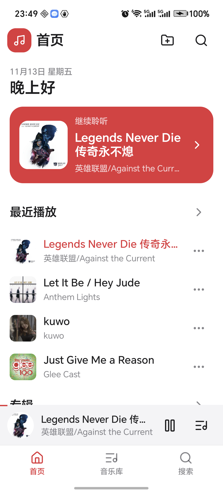
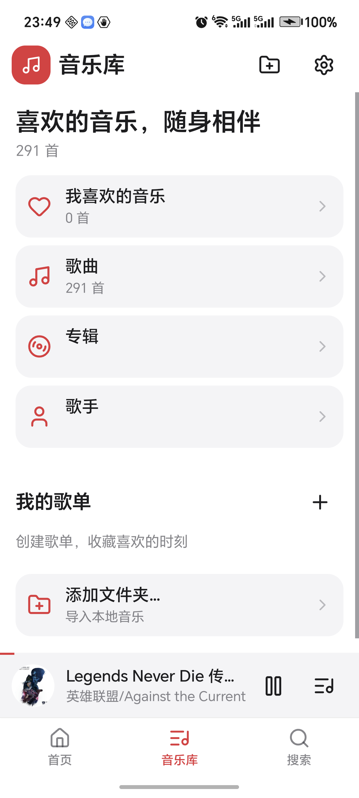
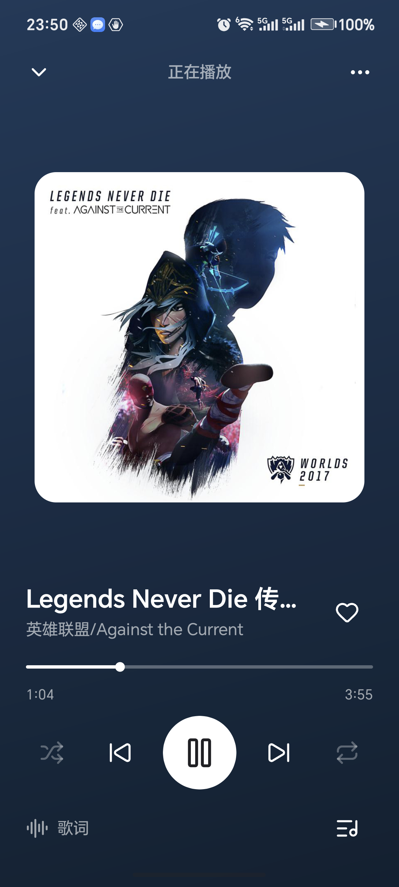
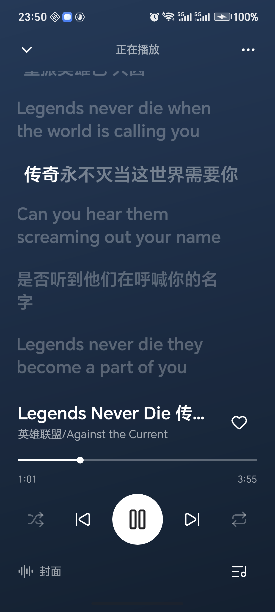
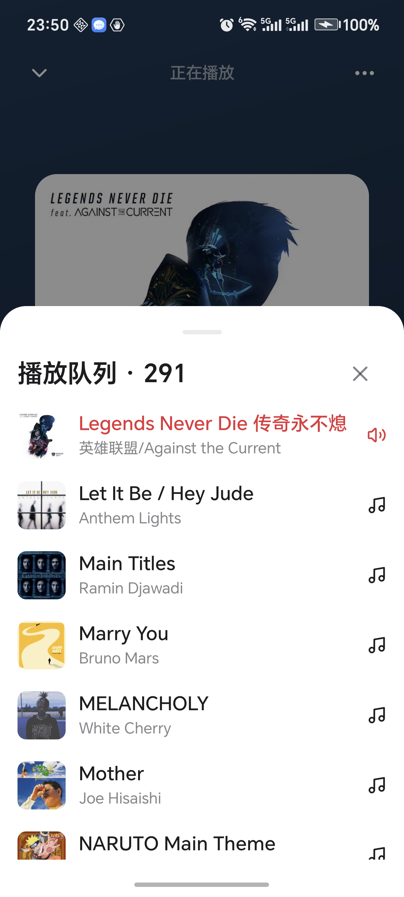
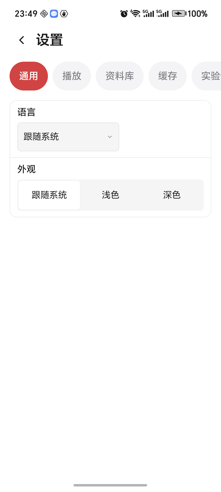

# 安卓移动端界面

0.1.24 起，手机宽度使用独立的 NSGo 界面；桌面继续使用侧栏和桌面播放条。曲库、播放队列、歌词、收藏、会话恢复与安卓后台播放保持共用。

## 使用方式

- **首页**：继续聆听、最近播放、横向滑动的专辑与歌单。
- **音乐库**：喜欢、歌曲、专辑、歌手、个人歌单，以及目录导入。右上角进入设置。
- **搜索**：搜索本地曲库，支持歌曲、歌手、专辑和歌单；保留搜索历史。
- **迷你播放条**：底部导航上方显示歌曲、播放/暂停和队列，点击歌曲展开播放页。音量交给系统音量键。
- **播放页**：大封面与随封面取色的背景；点击封面或底部歌词按钮切换歌词，歌词可点击跳转。顶部下滑可收起播放页。
- **底部面板**：队列、歌曲更多操作、添加到歌单、歌曲信息与歌单管理。点击遮罩、关闭按钮、系统返回键或下滑顶部抓手可关闭；列表内部手势用于滚动。

三个主入口分别保留页面层级和滚动位置。系统返回键先关闭当前弹出层，再关闭设置或播放页，最后返回页面。键盘显示时隐藏底部导航与迷你播放条。

界面根据可用窗口宽度切换：小于 720 个逻辑点使用手机布局，较宽窗口使用桌面布局。布局选择与音频输出方式无关。页面和主题切换不会重建安卓播放节点。

## 字体与大字体适配

0.1.26 统一手机端所有页面的字号、字重与间距，基础尺寸为逻辑点，仍由 NSGo 跟随系统字体设置缩放。

| 层级 | 基础字号 |
| --- | --- |
| 页面大标题 / 导航标题 | 22 / 20 |
| 分区标题 | 17 |
| 歌曲名 / 正文 | 15 / 14 |
| 艺术家与辅助说明 | 12–13 |
| 歌词 / 译文 | 21 / 13 |

标题以中等或半粗字重为主；歌曲与队列行在大字体下自动增高，按钮保留至少 48 个逻辑点的触摸高度。新建、重命名和删除歌单使用手机弹窗；键盘出现时弹窗上移，小屏时保存与取消并排显示。

## 界面预览

以下为 **荣耀 GT（Android 16）运行 0.1.26 的实际截图**，原始分辨率为 1200 × 2664，系统字体比例为 115%；使用手机已有的 291 首本地曲库，截图时播放《Legends Never Die 传奇永不熄》。

| 首页 | 音乐库 |
| --- | --- |
|  |  |

| 播放页 | 歌词 |
| --- | --- |
|  |  |

| 队列 | 设置 |
| --- | --- |
|  |  |

## 验证范围

自动化检查覆盖：

- 320 × 568、390 × 844 和 430 × 932 的播放页、迷你播放条与安全区边界。
- 底部导航的独立页面栈、搜索输入与焦点、滚动位置恢复、键盘状态。
- 封面/歌词切换、下滑收起、队列返回层级与 Escape 关闭面板。
- 收藏、添加/移除歌单歌曲、重命名歌单、100 首歌曲列表滚动和菜单定位。
- 目录导入、实际媒体协议、暂停与拖动进度、主题与页面切换保留播放节点。
- 100%、115%、150% 系统字体下，320 × 568 与 390 × 844 的所有页面、详情页、设置分类、歌词、队列、操作面板和歌单弹窗；验证键盘避让。
- 原有桌面端和播放逻辑回归。

执行：

```sh
go tool nsgo test
go tool nsgo check
WOODWIND_PHONE_SHOTS=1 go tool nsgo test -target macos -run '^TestPhoneShots$' ./internal/app
go run ./cmd/android
```

0.1.25 已在荣耀 GT（Android 16）完成真机复测，并修正设备时区、深色播放页状态栏图标和队列手势冲突。系统安全区、键盘、列表滚动、播放页与面板手势均已实测；后台和锁屏播放的进度记录见 [ANDROID-VALIDATION.md](ANDROID-VALIDATION.md)。
